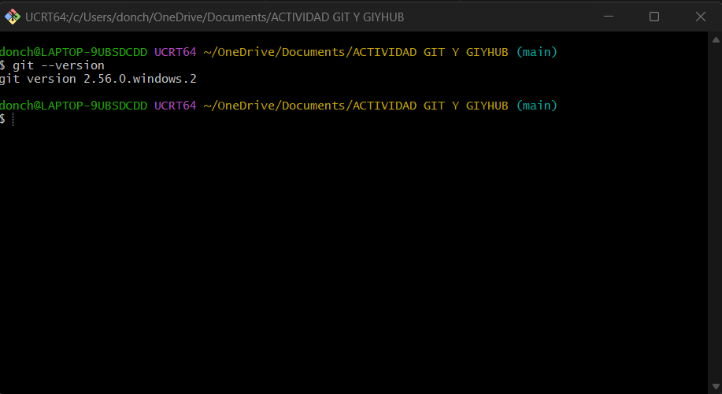
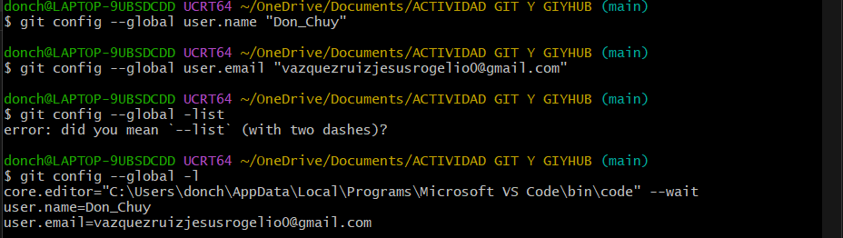

**Práctica de Git y GitHub**

**Alumno:** Jesús Rogelio Vázquez Ruiz

**Carrera:** Ingeniería en Sistemas y Tecnologías de la Información

**Universidad:** Benemérita Universidad Autónoma de Puebla

**Actividad:** Aprendizaje de Git y GitHub

* **¿Qué aprendí?**

En esta práctica conocí cómo es que se utiliza Git y GitHub para trabajar con proyectos. Aprendí a crear un repositorio, agregar archivos, guardar los cambios que voy realizando y subirlos a GitHub. También conocí la importancia de los commits, ya que estos permiten llevar un registro de los cambios que se hacen en un proyecto.

* **Comandos utilizados**

Estos son los comandos que utilicé durante la práctica:

* git --version: para revisar la versión de Git.
* git config --global: para configurar mi nombre y correo.
* git init: para crear un repositorio local.
* git status: para revisar el estado de los archivos.
* git add .: para agregar los archivos.
* git add -A: para agregar todos los cambios realizados.
* git commit -m: para guardar los cambios con un mensaje.
* git log: para consultar los commits realizados.
* git branch -M main: para establecer el nombre de la rama principal.
* git remote add origin: para conectar mi repositorio con GitHub.
* git remote -v: para comprobar la conexión.
* git push -u origin main: para subir mi proyecto a GitHub.
* git push: para enviar nuevos cambios al repositorio.

* **Dificultades encontradas**

Para comenzar no le entendí al video por lo que tuve que recurrir a que la IA e ayudara un poco ya que intente por un buen rato con los videos y no pude realizar nada. Pero a pesar de eso pude realizar la actividad.

Durante la actividad tuve un problema al crear mi archivo HTML, ya que Windows lo guardó como un documento de texto y agregó la extensión .txt. Para solucionarlo tuve que mostrar las extensiones de los archivos y cambiarle el nombre para que quedara correctamente como index.html.

También tuve que revisar algunos comandos para asegurarme de que los archivos se agregaran y se subieran correctamente a GitHub.

* **Evidencias**

**Verificación de la versión de Git**

**Configuración de usuario y correo**

**Creación del repositorio local**

**Creación del archivo HTML**

**Primer estado del repositorio**

**Agregar el archivo al seguimiento**

**Primer commit**

**Consultar el historial de cambios**

**Creación del repositorio en GitHub**

**Conexión del repositorio local con GitHub**

**Primer envío del proyecto a GitHub**

**Primer archivo subido a GitHub**

**Corrección de la extensión del archivo**

**Agregar los cambios corregidos**

**Segundo commit**

**Archivo HTML corregido en GitHub**

**Repositorio final con los dos archivos**

**Creación del archivo README**

**Subida del README a GitHub**

En el documento PDF se incluyen las capturas de pantalla de los pasos que realicé durante la práctica, desde la configuración de Git y la creación del repositorio hasta la subida de los archivos a GitHub.

